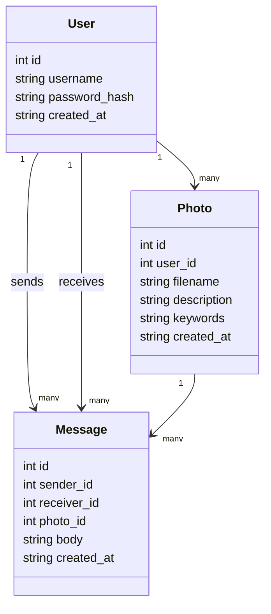
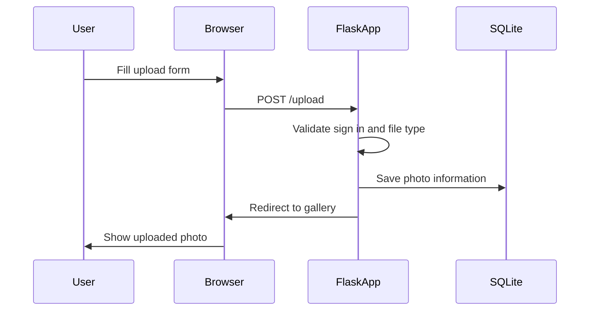
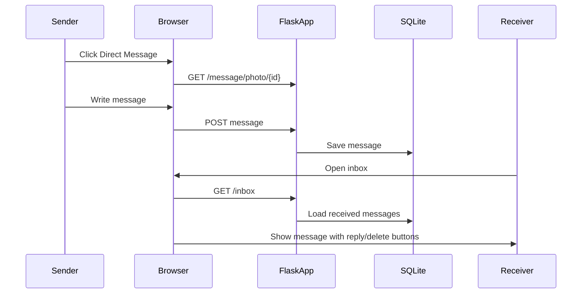

# UML Diagrams in Mermaid Format

You can paste these diagrams into a Mermaid editor or GitHub Markdown.

## Use Case Diagram

```mermaid
usecaseDiagram
actor Guest
actor SignedUser
Guest --> (See user list)
Guest --> (Sign up)
Guest --> (Sign in)
SignedUser --> (Sign out)
SignedUser --> (See user list)
SignedUser --> (See all photos)
SignedUser --> (Upload photo)
SignedUser --> (Edit own photo information)
SignedUser --> (Search photos by keyword)
SignedUser --> (Send direct message)
SignedUser --> (See inbox)
SignedUser --> (Reply to message)
SignedUser --> (Delete received message)
```

## Class Diagram



## Simple Sequence: Upload Photo



## Simple Sequence: Direct Message


